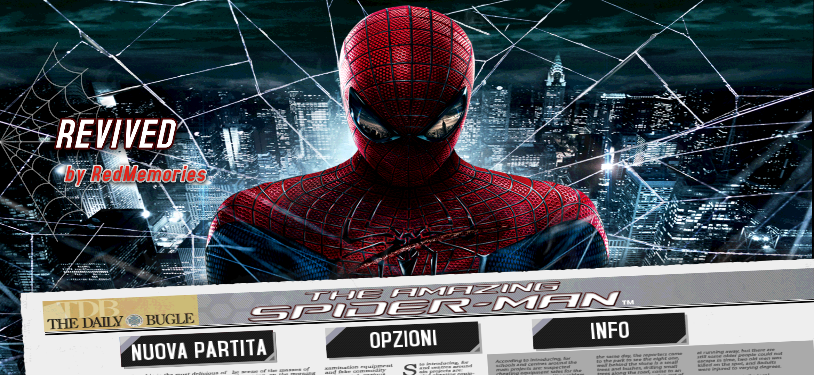
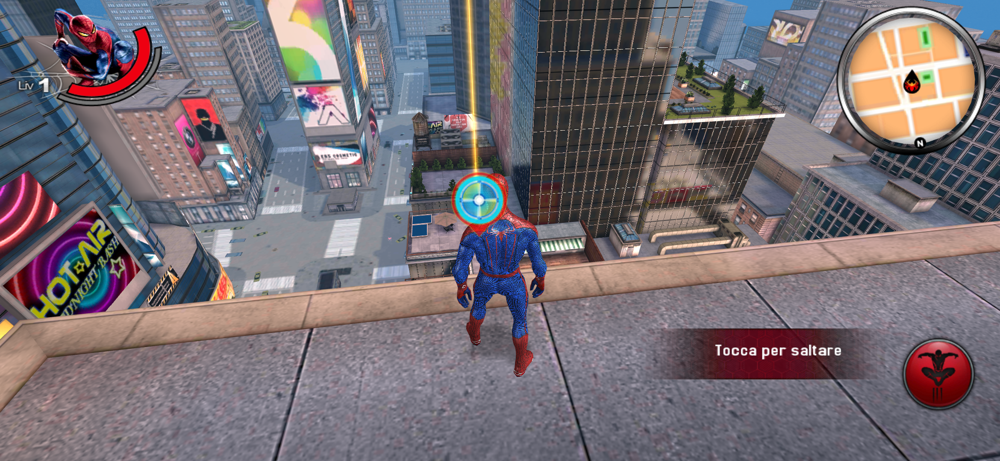
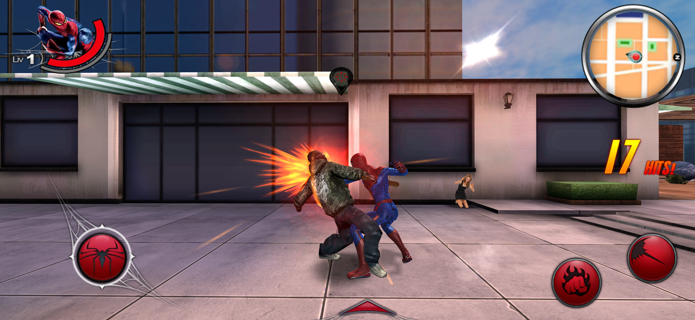
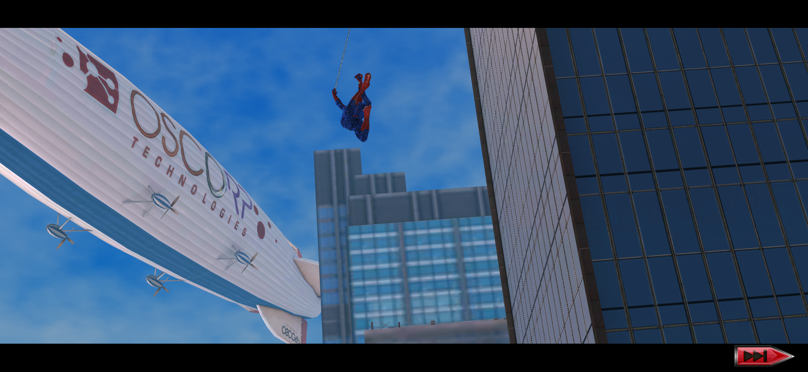
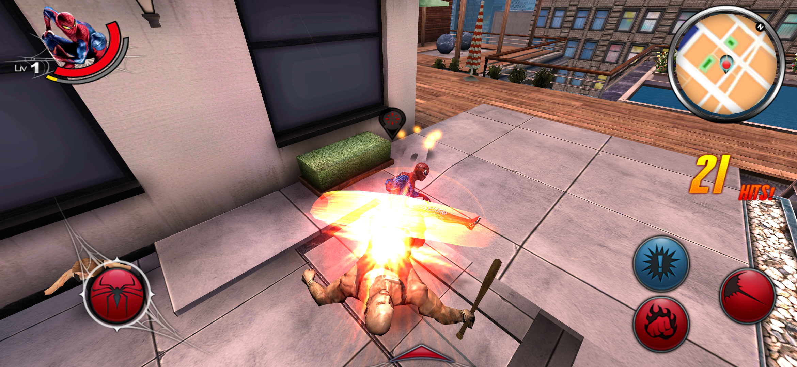
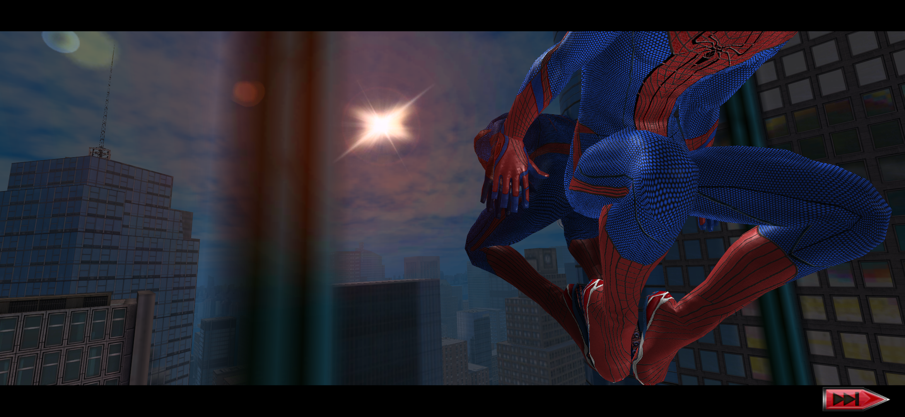

# The Amazing Spider-Man Revived

> Spider-Man is a trademark of Marvel. The Amazing Spider-Man mobile game is by Gameloft. This is a non-commercial fan project, not affiliated with Marvel, Sony or Gameloft. The game was pulled from the stores years ago. This repo is my private archive, please don't share the release files.

## What I did

I didn't remake the game and I didn't touch the gameplay. The original engine runs inside a new 64-bit app that translates its old code on the fly, so the city, the missions and the story are exactly the ones from 2012.

Once it was running, I gave it the treatment it deserves on a modern phone:

- full screen on today's tall displays, edge to edge, with the HUD no longer cut off on the right
- native resolution with 4x anti-aliasing, so edges are clean instead of jagged
- 32-bit color instead of the original 16-bit
- the highest graphics profile: the game didn't recognize modern GPUs and fell back to its low-end phone settings, now it always uses the full one, with higher resolution textures, bloom, lens flares, depth of field, longer draw distance and more cars and people in the streets
- sharper textures, especially roads and buildings seen at an angle
- a steady 60 fps

I also cleaned up everything that was left over from Gameloft's online stuff. The game is now fully offline, with no ads and no tracking, and it doesn't ask for any permission. The buttons that sent you to services that don't exist anymore (Gameloft LIVE, More Games, cloud saves, Twitter and Facebook sharing) are gone, and so are the buttons to buy in-game money with real money. The old downloader and the Google Play license check, which can't work anymore, are gone too: the game data is packed inside the APK, so there's nothing to download separately.

You can also play with a controller. Connect a gamepad (Bluetooth or USB) and the game switches to the controls it originally had for the Xperia Play, menus included: D-pad or left stick to move, A to jump and confirm, right stick to turn the camera. You can connect it even while you're playing. Without a controller nothing changes, the touch controls work as before.

## Install

1. Download the APK from **Releases**
2. Install it
3. Open it. The first launch takes a little while to unpack the game, after that it starts right away

No PC, no extra downloads, no account.

## Requirements

- 64-bit Android phone with Android 10 or newer
- about 2.5 GB of free space

I play it on a Galaxy S26 Ultra with Android 16. I haven't tried it on phones without a Snapdragon chip yet (MediaTek Dimensity, Exynos, Google Tensor): if you play on one of them, let me know how it runs.

## Credits

Revived by **RedMemories**

Thanks to the [dynarmic](https://github.com/azahar-emu/dynarmic) project, which makes running the old engine possible.

Original game by Gameloft.

☕ Support my work

If you enjoy my projects and would like to support my work, you can buy me a coffee on Ko-fi! Every project I create is and will always remain free, but any support is greatly appreciated and helps me keep working on new projects and improvements.

Thank you for your support! ❤️
[ko-fi.com/redmemories_ita](https://ko-fi.com/redmemories_ita)
